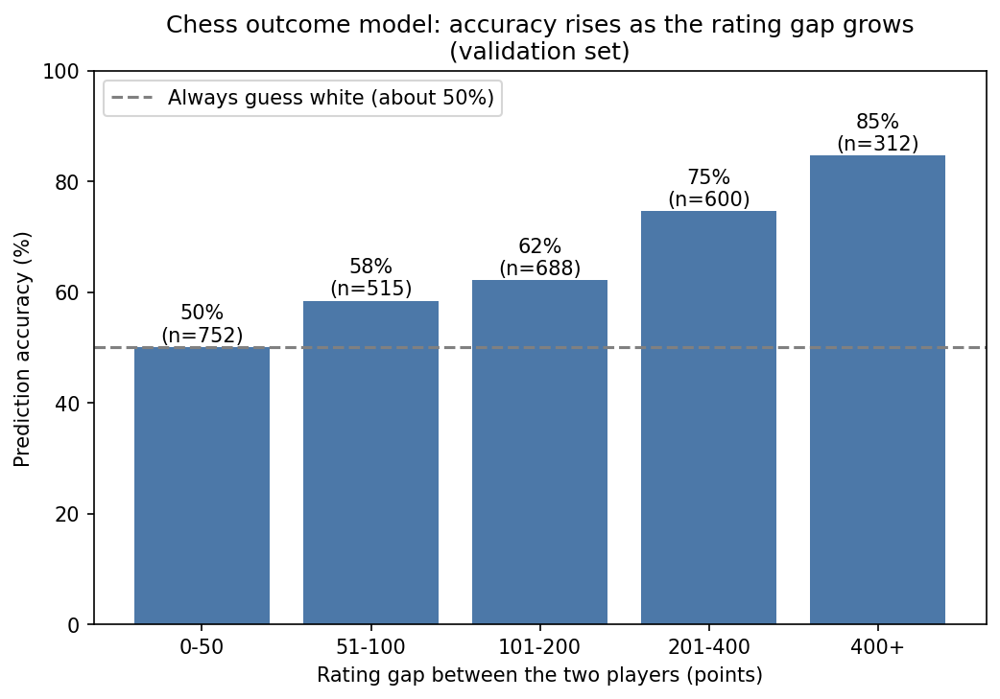

# Chess Outcome Predictor

**Live demo:** https://chess-outcome-predictor.streamlit.app/

Predicts the result of an online chess game (white win, black win or draw) from the two players' ratings.

## Problem

Before a game starts, the only information we have about it is who is playing. This project asks how well the players' ratings alone can predict the winner, and where that prediction stops working.

## Data

About 20,000 online games (rated and casual) from Lichess, taken from the Kaggle dataset [Chess Game Dataset (Lichess)](https://www.kaggle.com/datasets/datasnaek/chess) by datasnaek. After removing duplicate game ids, 19,113 games remain. Each game has the white and black players' ratings and the result (white, black or draw). About 5% of games end in a draw.

## Method

- **Feature:** one number, `rating_diff = white_rating - black_rating`.
- **Model:** scikit-learn `LogisticRegression` (scikit-learn 1.6.1), predicting one of three classes: `black`, `draw`, `white`.
- **Evaluation:** The data was split 70% training (13,379 games), 15% validation (2,867) and 15% test (2,867), keeping the same mix of white wins, black wins and draws in each. Model choices were compared on the validation set, and the final model was scored once on the test set.
- **Baseline:** always guessing "white wins", which is right about 50% of the time.

## Results

| Metric | Accuracy |
| --- | --- |
| Baseline (always guess white) | about 50% |
| Validation accuracy | 63.4% |
| Final test accuracy | 61.95% |

The test score is about 1.5 points lower than the validation score, which is within the noise expected from about 2,900 games per set.

Accuracy depends heavily on how far apart the two players' ratings are (validation set):

| Rating gap | Accuracy |
| --- | --- |
| 0-50 | 50% |
| 51-100 | 58% |
| 101-200 | 62% |
| 201-400 | 75% |
| 400+ | 85% |



When the players are close in rating, the model does no better than a coin flip. When one player is rated 400 or more points higher, the model is right 85% of the time.

## What did not help

These were tried and gave no improvement beyond noise (all around 63% validation accuracy):

- Adding time control and the rated/casual flag as features.
- Adding the average rating and the individual ratings.
- Adding the opening family (the ECO code letter).
- Random forests.
- Feature scaling.

A random forest with unlimited depth overfit badly: 85% accuracy on the training set but 58% on validation.

## Limitations

- **Draws cannot be predicted.** Draws are only about 5% of games, and none of the features I tried (ratings, time control, opening family) separated them from decisive games. The model never predicted a draw on the validation or test sets. Class weighting made it predict some draws, but only about 6% of those predictions were correct, and overall accuracy fell to 51-54%, so it was not used.
- **Close games are a coin flip.** For rating gaps under 50 points the model is at the 50% baseline.
- **One source of games.** All games come from Lichess, so the results may not carry over to other sites or to over-the-board play.
- **Ratings only.** The model knows nothing about the players beyond their ratings, such as recent form or experience with the opening.

## Data leakage

The columns `victory_status`, `turns` and the list of moves were excluded. They are only known after the game ends, so using them would let the model "see" the result and would make its accuracy look much better than it would be on a real upcoming game.

## How to run locally

Requires Python 3. From the project folder:

```bash
python -m venv .venv
```

Activate the virtual environment:

```bash
# Windows
.venv\Scripts\activate

# macOS / Linux
source .venv/bin/activate
```

Install the dependencies and start the app:

```bash
pip install -r requirements.txt
streamlit run app.py
```

The app opens in your browser at http://localhost:8501.

## Project files

| File | Purpose |
| --- | --- |
| `app.py` | Streamlit app: enter two ratings, see the predicted probabilities. |
| `chess_model.joblib` | The trained logistic regression model. |
| `images/accuracy_by_gap.png` | Chart of validation accuracy by rating gap. |
| `requirements.txt` | Python packages and versions needed to run the app. |
